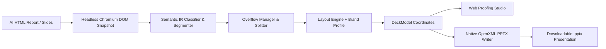

<div align="center">

# 📊 htmlppt

**Turn AI-generated HTML reports and web slides into native, fully editable PowerPoint presentations.**

[](https://www.python.org/)
[](https://fastapi.tiangolo.com/)
[](https://react.dev/)
[](https://www.typescriptlang.org/)
[](https://tailwindcss.com/)
[](https://playwright.dev/)
[](LICENSE)

[Quickstart](#-quickstart) • [Features](#-key-features) • [Architecture](#-architecture) • [Brand Profiles](#-brand-profiles--templates) • [CLI](#-cli-usage) • [API](#-api-endpoints)

</div>

---

## 💡 What is `htmlppt`?

Most HTML-to-presentation tools simply take full-page browser screenshots and paste static images onto slide canvases. This creates blurry text, impossible-to-edit numbers, and oversized presentation files.

**`htmlppt` takes a radically different approach:**
It extracts computed DOM geometries, typography runs, CSS grid structures, and chart specifications using headless Chromium, translates them into an intermediate representation (IR), and compiles them into **true, native OpenXML PowerPoint vector shapes, editable tables, text boxes, and data charts**.

Every word is real text you can edit in PowerPoint or Keynote. Every box is an auto-shape. Every chart and table retains its native rows, columns, and color themes.

---

## ✨ Key Features

- **🎯 True Native PowerPoint Elements**: Converts HTML headings, paragraphs, ordered/unordered lists, KPI tiles, data tables, and cards into native PowerPoint shapes.
- **📈 Native Data Charts & Tables**: Probes Chart.js, ECharts, Plotly, or HTML tables and recreates them as real vector tables or chart elements with color palettes.
- **🎨 Brand Profile & Corporate Design Ingestion**:
  - Upload your organization's `.pptx` or `.potx` template to automatically extract slide masters, color roles (`accent1`-`6`, `dk1`/`lt1`), and font pairings.
  - Upload past slide decks to statistically infer your brand design language.
  - Export and import portable `.htmlppt-brand` packages.
- **📐 5 Built-in Design Presets**:
  - `corporate`: Classic accent bars under titles, balanced spacing, banded tables.
  - `minimal`: Generous whitespace, thin hairlines, restrained typography.
  - `bold`: High-contrast colored headers, rounded cards, punchy KPI metrics.
  - `data-dense`: Compact consulting layouts, tight margins, high information density.
  - `executive`: Centered refined headings, subtle underlines, understated luxury.
- **⚡ Intelligent Overflow Splitting**: Automatically detects when bullet lists or complex multi-block elements exceed slide boundaries and gracefully splits them into continuation slides (`(cont.)`) with unique IDs.
- **🖥️ Presentation Proofing Studio (Web UI)**:
  - Container-query powered slide preview canvas (`cqw`) providing 100% geometric and typographic fidelity at any zoom level.
  - Drag-and-drop or paste HTML with sample loaders (*Executive Strategy*, *Financial Review*).
  - Reorder slides, delete slides, or switch layout archetypes on the fly.
  - Full-screen lightbox inspector with speaker notes and detailed element breakdown.

---

## 🏛️ Architecture



---

## 🚀 Quickstart

### Prerequisites
- **Python 3.11+**
- **Node.js 18+** & npm (for UI development)

---

### Option 1: Run the Web Studio (60 Seconds)

1. **Clone the repository**:
   ```bash
   git clone git@github.com:kelvinyee00/html-ppt.git
   cd html-ppt
   ```

2. **Set up the Python backend**:
   ```powershell
   cd backend
   python -m venv .venv
   .venv\Scripts\Activate.ps1
   pip install -e .
   playwright install chromium
   ```

3. **Start the server**:
   ```powershell
   python -m uvicorn htmlppt.api.app:app --port 8000
   ```
   > *Note:* The backend automatically serves the pre-built React presentation studio from `http://localhost:8000`!

4. Open your browser at **[http://localhost:8000](http://localhost:8000)**. Paste any HTML or click **"Sample: Executive"**, select your style preset, and click **Compile to PowerPoint (.pptx)**!

---

### Option 2: Frontend Hot-Reload Development

If you want to customize the React UI with instant Hot Module Replacement (HMR):

1. **Start the Backend API**:
   ```powershell
   cd backend
   .venv\Scripts\Activate.ps1
   python -m uvicorn htmlppt.api.app:app --reload --port 8000
   ```

2. **Start the Frontend Dev Server** (in a separate terminal):
   ```powershell
   cd frontend
   npm install
   npm run dev
   ```

3. Open **[http://localhost:3000](http://localhost:3000)**. Vite will automatically proxy all `/api` calls to the FastAPI backend on port 8000.

---

### Option 3: Command-Line Interface (CLI)

You can convert any HTML file straight to `.pptx` from your terminal without opening a browser:

```powershell
# Basic conversion with corporate preset and ocean palette
python -m htmlppt.cli convert ai_automotive_motor_ecu_v_cycle.html -o deck.pptx

# Convert with minimal preset and forest palette
python -m htmlppt.cli convert report.html -o deck.pptx --preset minimal --palette forest

# Convert with dark theme
python -m htmlppt.cli convert report.html -o deck.pptx --preset bold --dark

# Inspect semantic structure without generating PPTX
python -m htmlppt.cli convert report.html --explain

# View all presets and palettes
python -m htmlppt.cli presets
python -m htmlppt.cli palettes
```

---

## 🎨 Brand Profiles & Templates

`htmlppt` allows organizations to maintain strict brand compliance:

1. **Extract Corporate Design from `.potx` / `.pptx`**:
   Navigate to the **Brand Profiles & Templates** tab in the web UI. Upload your company's master presentation template. `htmlppt` extracts:
   - Primary and secondary font families
   - Slide master layout coordinates and margins
   - 12-color theme palette (`dk1`, `lt1`, `dk2`, `lt2`, `accent1`-`accent6`)
   - Corner radius and card styles
2. **Statistical Deck Analysis**:
   Upload 2–10 past presentations. The statistical analyzer determines your organization's most frequently used color roles, text sizes, and title placements.
3. **Export / Import**:
   Download a standalone `.htmlppt-brand` file to share design tokens with your team.

---

## 🔌 API Endpoints

The FastAPI backend provides clean REST endpoints with interactive documentation at `http://localhost:8000/docs`:

| Method | Endpoint | Description |
| :--- | :--- | :--- |
| `POST` | `/api/jobs` | Converts HTML string or uploaded file into positioned slide models |
| `GET` | `/api/jobs/{job_id}` | Retrieves the current deck model and slide state |
| `PATCH` | `/api/jobs/{job_id}/slides` | Reorders slides, deletes slides, or overrides layout archetypes |
| `GET` | `/api/jobs/{job_id}/pptx` | Compiles and streams the native OpenXML PowerPoint `.pptx` file |
| `GET` | `/api/presets` | Lists style presets (*corporate*, *minimal*, *bold*, *data-dense*, *executive*) |
| `GET` | `/api/palettes` | Lists built-in curated color palettes |
| `GET` | `/api/brands` | Lists saved corporate brand profiles |
| `POST` | `/api/brands` | Saves or updates a brand profile |
| `POST` | `/api/brands/extract-template`| Extracts design tokens from an uploaded `.potx`/`.pptx` file |
| `POST` | `/api/brands/analyze-decks` | Infers design tokens from multiple uploaded `.pptx` decks |
| `GET` | `/api/brands/{id}/export` | Exports a brand as an `.htmlppt-brand` bundle |
| `POST` | `/api/brands/import` | Imports an `.htmlppt-brand` bundle |

---

## 🧪 Testing & Verification

The test suite covers DOM snapshotting, semantic segmentation, layout overflow splitting, OpenXML generation, and API contract validation.

```powershell
cd backend
.venv\Scripts\Activate.ps1
python -m pytest -v
```

To type-check and lint the frontend:

```powershell
cd frontend
npx tsc -b
npx oxlint
```

---

## 📂 Project Structure

```
html-ppt/
├── backend/
│   ├── htmlppt/
│   │   ├── analyze/        # Semantic DOM classifier, IR builder, and segmenter
│   │   ├── api/            # FastAPI routes for jobs, brands, presets, and downloads
│   │   ├── brand/          # Template extractor, statistical analyzer, presets, store
│   │   ├── extract/        # Playwright headless DOM renderer and chart probe
│   │   ├── layout/         # 13 slide archetypes, text-fitting, and overflow splitter
│   │   ├── render/         # Native PowerPoint OpenXML shape, table, and text writer
│   │   └── cli.py          # Command-line interface
│   ├── tests/              # Automated pytest suite and test fixtures
│   └── pyproject.toml      # Python dependencies and metadata
├── frontend/
│   ├── src/
│   │   ├── api/            # API client with typed error handling
│   │   ├── components/     # SlidePreview (cqw scaled), SlideGrid, PresetPicker, Navbar
│   │   ├── lib/            # Archetype definitions and EMU-to-CSS scaling units
│   │   ├── pages/          # ConvertPage (Workbench) and BrandsPage (Brand Studio)
│   │   └── types.ts        # Discriminated union types for slide elements
│   ├── package.json
│   └── vite.config.ts
├── data/                   # Brand profile database storage (gitkeep)
├── ai_automotive_motor_ecu_v_cycle.html  # Included sample engineering presentation
└── README.md
```

---

## 📄 License

This project is licensed under the [MIT License](LICENSE).
